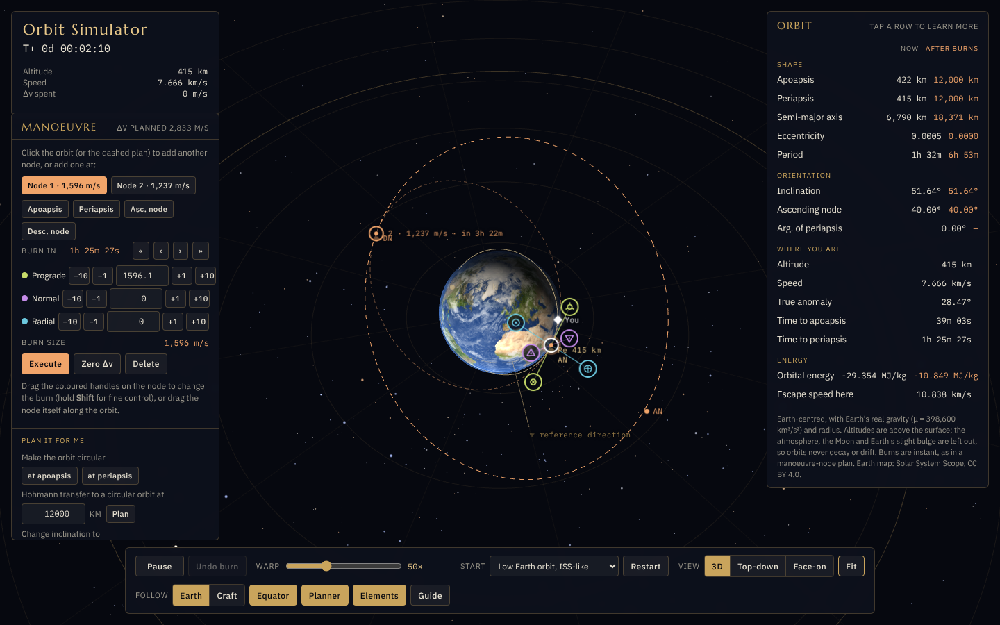

# Orbit Simulator

**[▶ Open the live orbit simulator](https://hughesalex.github.io/OrbitSimulator/orbit-simulator.html)**

An interactive sandbox for learning how orbits work, in the style of the [Orrery](https://hughesalex.github.io/orrery/orrery.html).

A spacecraft circles Earth (or the Moon, Mars or Ganymede), in a Solar System with the Sun, all eight planets and nineteen of their major moons on their real orbits. Click anywhere on its orbit to drop a manoeuvre node, then drag the coloured handles (or use the buttons in the Manoeuvre panel) to push prograde, normal or radial, as in Kerbal Space Program. Plan up to six burns in a row: the dashed orange path shows where each one takes you, and the Orbit panel compares apoapsis, periapsis, eccentricity, inclination and the other elements now and after the burn you pick. Tap any row for an explanation.

- **The plan as a timeline.** The Manoeuvre panel lists the plan in time order: each burn, with what it changes, and the events between burns that need no burn, such as reaching the Moon's sphere of influence or passing closest to it. On the map, burns are round nodes and events are diamonds. Each burn is planned from where the burns before it leave you.
- **Plan it for me** works out the burns to put you in a circular orbit round the nearest body, make a Hohmann transfer to any altitude, change inclination (to a number, or into the plane of a moon's or planet's orbit), or **transfer to** any planet or major moon one step away: a neighbour round the same parent, the parent itself, or one of your body's moons, passing at the height you choose and braking into orbit there if you like. Where there is more than one way, it lays them side by side with the fuel and time each takes, from least fuel to quickest, and shows whichever you click on the map.
- **Why these ways?** Each transfer between planets or moons comes with an explanation: launch windows and the synodic period, why faster trips cost more at both ends, the Oberth effect of burning low, why going inward is not downhill, when a bi-elliptic transfer (out first, brake far away) pays and when it does not, and a **porkchop plot** of fuel against departure date and trip time. Click anywhere on the plot to plan that departure. Gravity assists are left out for now; the planner is built so they can be added as extra legs later.
- **What it means for a real rocket.** Pick an engine (storable hypergolic, kerosene/oxygen, hydrogen/oxygen, nuclear thermal, ion, and speculative fusion and antimatter) and each way on offer shows, from the rocket equation, how many tonnes you would need at departure for every tonne that arrives, with a traffic light (routine, hard, not practical) and a comparison with missions that have flown. Nothing is ruled out; a "hide impossible" box tidies the list.
- **Planes** shows the plane of your orbit and the plane of the Moon's orbit as discs through Earth, the angle between them, and the line of nodes where they cross, with how long until the Moon reaches each end. A cheap transfer can only meet the Moon there, which is why leaving the ISS-like orbit for the Moon can mean waiting days. The Orbit panel also lists your orbit's tilt to the Moon's.
- **Launch…** starts from the ground at Cape Canaveral, Baikonur, Kourou, Vostochny, Wenchang, Jiuquan, Tanegashima or Sriharikota, into a circular parking orbit at the height you choose. Say where you're going first: for Earth orbit you launch now, due east (the least tilt, the site's latitude) or steeper at a cost; for the Moon you get a week of launch times, about two a day, each timed so the Moon will lie in your orbit's plane when the slow transfer arrives, with the local time, tilt, heading and extra Δv of each. It then plans the transfer, which leaves within the hour.
- **The Moon, the planets and their moons** move on their real orbits (JPL mean elements for the planets), dated from the moment you open the page. Inside each body's sphere of influence only its gravity counts, as in Kerbal Space Program, so you can fly from Earth to Mars, be captured into orbit, hop to Phobos, or tour Jupiter's moons. A planned path shows each body where it will be when you arrive.
- **Fly by hand** fires the engine live while you hold a button or W/S, Q/E, D/A.
- **Undo burn** (Ctrl+Z) puts the craft back as it was before the last burn, planned or hand-flown, even after a crash, with the node back on the plan.
- **View** swings the camera to 3D, Top-down (above the North Pole) or Face-on (square to the orbit); **Fit** zooms to the whole plan; **Follow** keeps the craft, the Sun or any planet or moon in the centre (or click a body's label); zoom out to see the whole Solar System.
- The **Guide** button explains the controls and suggests things to try.

Starting orbits: an ISS-like low orbit, an equatorial parking orbit, a geostationary transfer orbit, geostationary, Molniya, sun-synchronous polar, a suborbital hop, an escape trajectory, a low lunar orbit, a low Mars orbit and a polar orbit round Ganymede, or launch from the ground.

The physics is exact two-body motion (Kepler's laws) with instant node burns, patched together at the edges of the spheres of influence (patched conics). There is no air drag, no equatorial bulge, and the planets' orbits do not slowly turn.

## Files

`orbit-simulator.html` is the whole app: a single file that works offline. Use the [live page](https://hughesalex.github.io/OrbitSimulator/orbit-simulator.html), or download the file and open it straight from disk in a browser.

It is built from `src/orbit-simulator.html` by `build.sh`, which embeds the files in `vendor/`: fonts, three.js r128 and its OrbitControls, the Sun, planet, Moon and ring maps from Solar System Scope (CC BY 4.0), all taken from the Orrery, plus `sky.js` with the bright-star catalogue and cloud map. Edit the source, then run `bash build.sh`.
